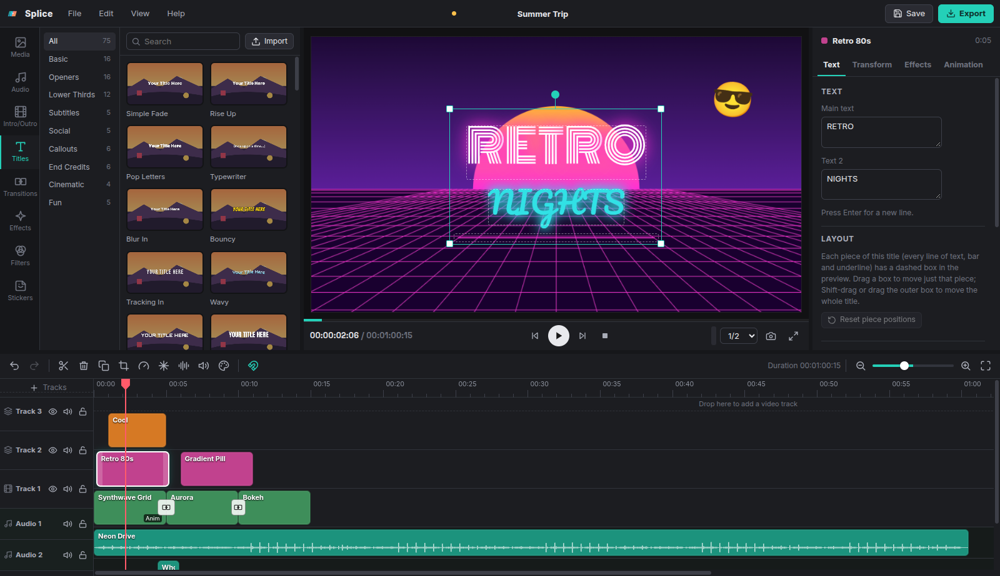
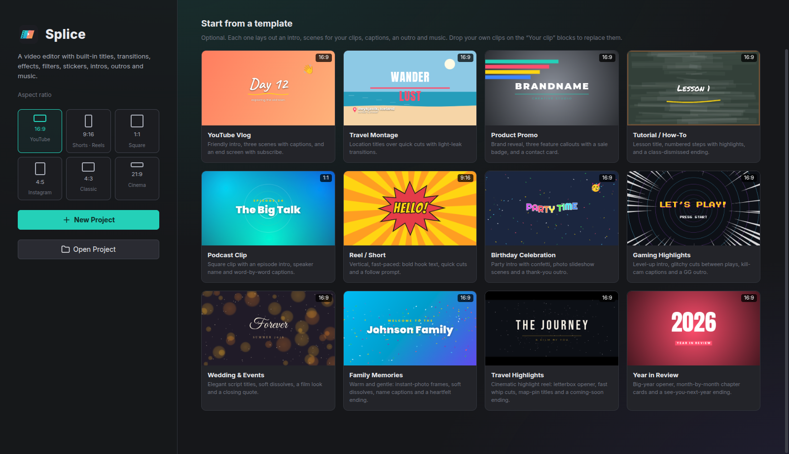
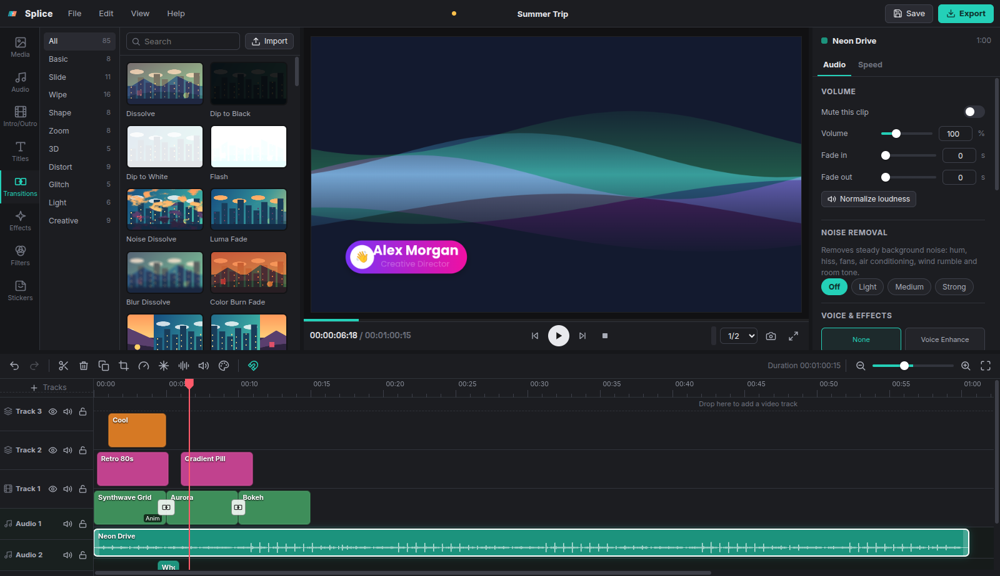

# Splice

A video editor built around ready-made templates. Drag animated titles, transitions, effects, colour filters, stickers, backgrounds, music and sound effects onto a multi-track timeline, layer clips with green screen and picture-in-picture, clean up audio, and export to MP4, MOV, WebM or MP3.



## What's in the box

| Library | Count | Examples |
|---|---|---|
| Starter templates | 12 | YouTube vlog, travel montage, travel highlights, product promo, tutorial, podcast clip (1:1), reel/short (9:16), birthday, family memories, gaming highlights, wedding, year in review |
| Intros & outros | 25 + 25 | Ready-made openings and endings built from separate clips, so every text and piece can be edited and moved |
| Titles | 75 | Openers, lower thirds, subtitles (incl. word highlight), social, callouts, quotes, countdowns, end credits |
| Transitions | 85 | Dissolves, dips, wipes, slides, whip pans, zooms, spins, 3D cube/flip/page turn, glitch, film burn, light leak, shapes |
| Effects | 55 | Blur, tilt shift, fisheye, VHS, old film, CRT, glitch, comic book, shake, mirror, kaleidoscope, rain, snow, dreamy glow |
| Filters | 50 | Cinematic, film stocks, vintage, black & white, moods, food & travel |
| Stickers | 100 | Animated emoji, 20 annotations (circles, highlighter, tooltips, star rating, spotlight…), 15 arrows (straight, double, block, elbow, U-turn, rotate, curved, neon, rainbow, sparkle trail…), confetti, frames |
| Backgrounds | 78 | Solid colours (incl. green/blue screen), gradients, radial glows, animated, patterns, scenes and textures |
| Audio | 50 | 20 music beds and 30 sound effects, generated on first use |
| Fonts | 22 | Bundled display and script fonts for titles |

Every card animates when you hover over it, and the **+** button adds it at the playhead. Hover a music, sound or video card and press play to hear it first.

New projects start blank. The start screen also offers the 12 starter templates; pick one and drop your own clips onto its “Your clip” blocks.



## Editing

- **Multi-track timeline** with snapping, trimming, ripple delete, split (Ctrl+B), duplicate, copy/paste, marquee selection, undo/redo, and track hide, mute and lock.
- **Layering:** clips on higher tracks sit on top. Each clip has position, scale, rotation, flip, crop, opacity and 9 blend modes, with drag handles in the preview.
- **Crop** with drag handles in the preview, aspect presets (16:9, 9:16, 1:1…) and fill/fit after cropping.
- **Green screen / blue screen:** chroma key with tolerance (default 15), edge softness, spill removal and a colour picker that samples the preview.
- The move/resize box hugs the actual sticker or text, and scaling or rotating keeps it in place.
- **Every piece of a title is movable:** each line of text, bar and underline has its own dashed box in the preview. Drag one to move just that piece; Shift-drag moves the whole title.
- **Pick from preview** samples any pixel, including a keyed clip on top; one click picks and returns to normal, Esc cancels.
- **Picture in picture:** right-click a clip and choose *Picture in picture*, or use the corner presets in the Video tab.
- **Adjustment layers:** drop an effect or filter on an empty part of a track to apply it to everything below.
- **Animation:** 14 entrance and exit motions and 9 continuous ones (Ken Burns, pan, pulse, float, shake…).
- **Speed** from 0.1× to 8×, freeze frame and colour correction (exposure, contrast, highlights, shadows, temperature, tint, hue, vignette, sharpen).

## Audio



- Volume up to 400%, fade in and out, mute per clip or track, and **Normalize loudness** (peaks to −1 dB).
- **Noise removal** (light, medium, strong): spectral gating that learns the noise floor from the quietest parts of the clip and removes hum, hiss, fans and room tone.
- **Voice and effect presets:** voice enhance, podcast voice, telephone, old radio, megaphone, echo, small room, concert hall, cathedral, underwater, next room, bass boost, robot and lo-fi, each with a dry/wet mix.
- **Equalizer** (bass, mid, treble), low-cut filter and compressor.
- Split audio clips like any other clip, and **Detach audio** from a video to edit it on its own track.
- Speed changes keep the natural pitch.

## Requirements

- Ubuntu 24.04 or newer (tested on Ubuntu 26.04 with GNOME 50)
- A GPU with WebGL 2 (any driver from the last decade)
- GStreamer for export: `gstreamer1.0-plugins-good`, `-ugly` and `-libav` (the deb installs these)

Splice has only been tested on Ubuntu 26.04.

## Install

### With the deb package (recommended)

Download `splice_1.2.0_amd64.deb` from the [latest release](https://github.com/webhookstudios/splice/releases/latest), then install it:

```bash
sudo apt install ./splice_1.2.0_amd64.deb
```

Open **Splice** from the apps menu. To remove it:

```bash
sudo apt remove splice
```

### From source

```bash
git clone https://github.com/webhookstudios/splice.git
```

```bash
cd splice && npm install && ./install.sh
```

Or run it straight from the checkout with `npm start`.

## Using it

| To do this | Do this |
|---|---|
| Start a project | Pick an aspect ratio (16:9, 9:16 for Shorts and Reels, 1:1, 4:5, 4:3, 21:9) and click **New Project** |
| Add media | Click **Import**, or drop files on the library or straight onto the timeline |
| Add a template | Drag it to a track, or hover and click **+** |
| Add a transition | Drop it on the cut between two clips (or on a clip's start or end to fade from or to black) |
| Apply an effect or filter to one clip | Drop it on the clip |
| Edit a clip | Select it and use the panel on the right |
| Crop a clip | Select it, open **Crop**, and drag the handles in the preview |
| Key out a green screen | Put the clip on a track above the background, crop off anything the screen does not cover, then **Green Screen → Remove background colour** |
| Add an intro or outro | Open **Intro/Outro** and click **+** (intros go first, outros go last) |
| Clean up a voice | Select the clip, **Audio → Noise removal**, then try **Voice Enhance** |
| Export | Click **Export**, pick a format, resolution, frame rate and quality |

Press **?** in the app for all keyboard shortcuts.

## Building the package

```bash
npm install
```

```bash
./build-deb.sh
```

The package is written to `dist/`. It bundles Electron, so it is about 95 MB.

## Tests

```bash
./tests/make-media.sh
```

```bash
npx electron . --selftest=tests/smoke.js
```

The smoke test compiles every shader, draws every template at several points in time, builds a timeline with transitions, effects, music, noise removal and a title, and exports it through GStreamer.

## How it works

The editor is an Electron app. Each frame is composited in WebGL 2: every clip is placed into a frame-sized layer (transform, crop, chroma key), graded, run through its effects, mixed with its neighbour by a transition shader and blended onto the layers below. Titles, stickers and backgrounds are drawn with Canvas 2D. Audio plays through Web Audio effect chains. Export renders frame by frame with frame-exact seeking, mixes the audio offline through the same effect chains, and pipes raw frames and audio into GStreamer (x264, VP9, AAC, Opus, LAME).

## License

GPL-2.0-or-later. Bundled fonts are under the SIL Open Font License 1.1.
